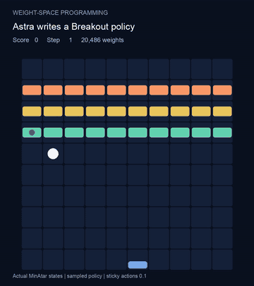
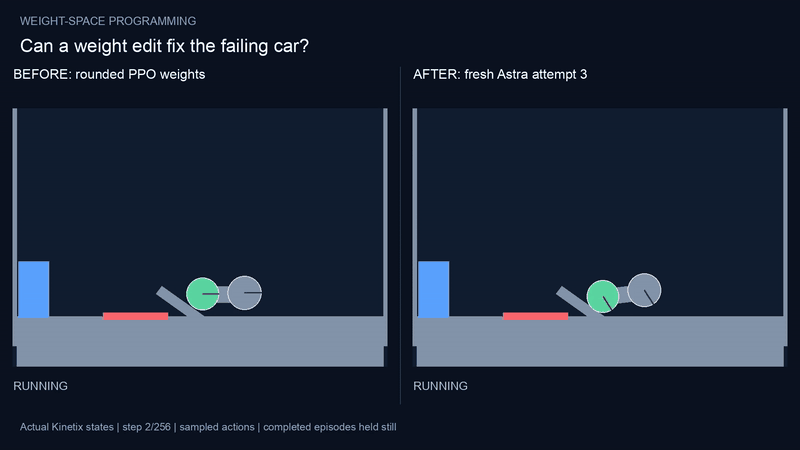

# Weight-Space Programming 재현

LLM이 신경망 가중치를 텍스트로 읽고, 도구·시뮬레이터·gradient descent 없이 답 한 번으로 새 가중치를 직접 써 넣는 실험입니다. MIT CSAIL의 [Sparks of Weight-Space Programming](https://rikiyat.github.io/blog/weight-space-programming/) (Takehi, Teoh, Zhang, Khattab, 2026년 11월 2일) 실험 두 개를 같은 모델·같은 프롬프트로 새로 돌려 재현했고, 코드·모든 답변·점수·영상을 공개합니다.

[English README](README.md)

| | 벽돌깨기: 0에서 정책 쓰기 | 자동차: 실패하는 학습된 정책 고치기 |
|---|---|---|
| |  |  |
| 시작 | 전부 0인 600→32→32→6 망 (가중치 20,486개) | PPO로 10억 step 학습했지만 목표에 한 번도 못 가는 망 |
| LLM이 한 일 | 편집문 204개 작성, 가중치 1,248개를 0이 아닌 값으로 | 가중치를 읽고 실패 원인을 진단해 수정 |
| 결과 | 1,000판 평균 **416.8**점 | 독립 응답 **4개 중 1개** 성공: 같은 test 1,024판에서 **0 → 1,024** |

## 배경

신경망은 보통 gradient descent로 학습합니다. 돌려 보고, 오차를 재고, 모든 가중치를 조금씩 고치기를 수백만 번 반복합니다. weight-space programming은 이 반복을 건너뜁니다. 가중치를 숫자로 프롬프트에 넣으면, LLM이 각 유닛이 무엇을 계산하는지 추론해서 프로그램을 고치듯 바꿀 값을 직접 씁니다.

원문에서 GPT-6 Astra(`gpt-6-astra`)는
- 게임용 작은 망을 0에서 써서 PPO 1억 step 학습을 이겼고 (MinAtar Breakout: PPO 1억 step 15.8, 5억 step 25.3, Astra 517.4)
- PPO로는 성공시키지 못한 Kinetix 자동차 정책의 가중치 3.5%를 고쳐 256판 중 0판 → 1,024판 중 1,024판 성공으로 바꿨습니다.

답은 한 번뿐이고, 코드 실행·계산기·시뮬레이터·피드백이 없습니다. 편집은 답을 받은 뒤 적용해서 측정합니다.

## 우리가 한 것

원문 프롬프트를 byte 단위로 그대로, 도구를 모두 끈 Codex CLI(원문 `harness/codex_config.toml`)로 `gpt-6-astra`에 보냈고, 답은 직접 만든 파서로 적용하고 직접 만든 평가기로 측정했습니다.

- **벽돌깨기** (원문 exp5): 답 1회, effort xhigh, 820.8초, 출력 25,938토큰
- **자동차** (원문 exp4): 독립 답 4회, effort high. 매번 새 대화이고, 이전 답이나 평가 결과를 모델에 보여 주지 않았습니다. 네 번 모두 프롬프트에 적힌 같은 반올림 PPO 가중치에서 고칩니다.

이번 편집에는 gradient descent, 게임 실행 도구, 평가 피드백을 쓰지 않았습니다. (자동차의 출발 망 자체는 원문 저자가 PPO로 학습한 것이고, 저희는 다시 학습하지 않았습니다.)

## 결과

### 벽돌깨기

| 정책 | 판 수 | 평균 점수 |
|---|---:|---:|
| 원문: PPO 5억 step | | 25.3 |
| 원문: Astra | 1,000 | 517.4 |
| 원문 Astra 가중치, 우리 평가기 | 1,000 | 502.9 ± 7.7 |
| **이번 Astra 답** | 1,000 | **416.8 ± 6.9** |

MinAtar 1.0.15, sticky 0.1, softmax 샘플링, 최대 10,000 step. 영상은 한 판(71점)이고, 416.8은 1,000판 평균입니다.

### 자동차

| 시도 | 폴더 | 편집문 | 바뀐 가중치 | search /256 | test /1,024 | 출력 토큰 | 시간 |
|---|---|---:|---:|---:|---:|---:|---:|
| 수정 전 (반올림 PPO) | | | | 0 | 0 | | |
| 1 | `games/runs/car` | 1 | 1 | 0 | 0 | 3,914 | 199.9초 |
| 2 | `games/runs/car_repeat1` | 55 | 6,958 | 0 | 0 | 13,370 | 504.1초 |
| **3** | `games/runs/car_repeat2` | 55 | 6,703 | **256** | **1,024** | 16,095 | 642.0초 |
| 4 | `games/runs/car_repeat3` | 24 | 1,912 | 0 | 0 | 3,513 | 174.9초 |

Kinetix `l/h2_car_ramp`, search seed 0–255, test seed 100000–101023, 모든 정책이 같은 seed. 독립 답 네 개 중 하나가 test 1,024판 모두 성공했고 나머지 셋은 한 번도 성공하지 못했습니다. 관측 네 번이지, 모델의 성공 확률이 25%라는 뜻은 아닙니다.

성공한 답(시도 3)은 도움닫기와 발사 속도를 결정하는 부분을 고쳤습니다. 학습된 유닛 대부분은 그대로 두고 일부 유닛을 따로 떼어 제어하다가, 경사에서 속도가 충분하거나 위험 구간을 지나면 원래 정책에 제어를 돌려줍니다. 전체 답은 [`games/runs/car_repeat2/answer.md`](games/runs/car_repeat2/answer.md).

### 영상

모두 실제 시뮬레이터 상태를 그린 것입니다. 표는 [English README](README.md#videos) 참고: 벽돌깨기 한 판, 시도 3의 수정 전/후(seed 0, 72 step에 도착), 시도 1의 실패, 그리고 비교용 **원문 저자의** 공개 가중치 영상(저희 답 아님).

## 실행

설치, 기록된 답 다시 채점(LLM 불필요), 모델에 새 답 받기는 [English README의 Run it](README.md#run-it)과 [docs/REPRODUCTION.md](docs/REPRODUCTION.md)에 명령이 있습니다.

## 라이선스

저희 코드·답변·결과·영상은 MIT. 원문 저장소([RikiyaT/lm_understand-logs](https://github.com/RikiyaT/lm_understand-logs), commit `4d09ba6`)에서 가져온 자동차 프롬프트(원문 망 가중치 포함)와 tools-off 설정은 CC BY 4.0·MIT로 [NOTICE](NOTICE)에 고지했습니다. 벽돌깨기 프롬프트는 MinAtar 소스(GPL-3.0)를 담고 있어 넣지 않았고, `fetch_breakout_prompt.py`가 원문을 받아 SHA256을 확인합니다. MIT·원문 저자와는 관계없습니다.

## 만든 방법

"weight-space programming 조사해줘" 한 줄부터 실행, 보고, 영상, 이 저장소까지 모두 [emma](https://emma.now)에서 채팅으로 요청하고 주고받았습니다. emma는 사람과 코딩 에이전트(Claude Code, Codex)가 함께 일하는 메신저입니다.
