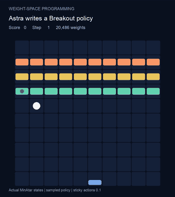
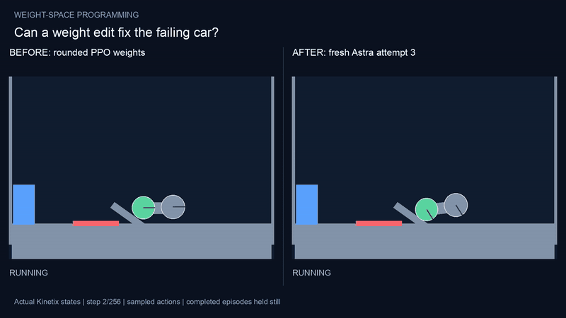

# Weight-Space Programming: an independent reproduction

An LLM reads a neural network's weights as text and writes new weights directly, in one reply, with no tools, no simulator and no gradient descent. This repository reproduces two experiments from MIT CSAIL's [Sparks of Weight-Space Programming](https://rikiyat.github.io/blog/weight-space-programming/) (Takehi, Teoh, Zhang, Khattab, Nov 2 2026) with fresh answers from the same model and the same prompts, and publishes the code, every answer, every score and the videos.

[한국어 README](README.ko.md)

| | Breakout: write a policy from zero | Car: fix a trained policy that fails |
|---|---|---|
| |  |  |
| Start | All-zero 600→32→32→6 network (20,486 weights) | PPO-trained network (1B steps) that never reaches the goal |
| What the LLM did | Wrote 204 edit statements; 1,248 weights became non-zero | Read the weights, diagnosed the failure, edited them |
| Result | **416.8** mean score over 1,000 games | **1 of 4** independent answers works: **0 → 1,024** of the same 1,024 test games |

## Background

A neural network is normally trained by gradient descent: run it, measure the error, nudge every weight a little, repeat millions of times. Weight-space programming skips that loop. The weights are printed as numbers in the prompt, and the LLM reasons about what the units compute and writes the changes itself, like editing a program.

In the original post, GPT-6 Astra (`gpt-6-astra`):

- wrote small game-playing networks from scratch that beat PPO trained for 100M steps (MinAtar Breakout: PPO 15.8 at 100M steps, 25.3 at 500M; Astra 517.4), and
- fixed a Kinetix car policy that PPO could not train to succeed, by changing 3.5% of its weights: 0 of 256 → 1,024 of 1,024 episodes.

Each answer is a single response. The model gets no code execution, no calculator, no simulator and no feedback; its edits are applied and measured afterwards.

## What we did

We ran the original prompts again, byte for byte, against `gpt-6-astra` through Codex CLI with every tool turned off (the original `harness/codex_config.toml`), then applied the answers with our own parser and measured them with our own evaluators.

- **Breakout** (original exp5): one answer, effort xhigh, 820.8 s, 25,938 output tokens.
- **Car** (original exp4): four independent answers, effort high. Each one is a new conversation; earlier answers and evaluation results were never shown to the model. All four are edited from the same rounded PPO weights printed in the prompt.

Nothing in these edits used gradient descent, a game-running tool or evaluation feedback. (The car's starting network itself was trained with PPO by the original authors; we did not retrain it.)

## Results

### Breakout

| Policy | Games | Mean score |
|---|---:|---:|
| Original post: PPO, 500M steps | | 25.3 |
| Original post: Astra | 1,000 | 517.4 |
| Original Astra weights, our evaluator | 1,000 | 502.9 ± 7.7 |
| **Our fresh Astra answer** | 1,000 | **416.8 ± 6.9** |

MinAtar 1.0.15, sticky actions 0.1, sampled softmax actions, 10,000-step cap. The video shows one game (71 points); the 416.8 is the 1,000-game average. Astra's own summary of its design:

> The policy predicts the two catchable paddle cells, including wall reflections. While rising, it anticipates the next possible brick collision.

### Car

| Attempt | Folder | Edit statements | Weights changed | Search /256 | Test /1,024 | Output tokens | Time |
|---|---|---:|---:|---:|---:|---:|---:|
| Before any edit (rounded PPO) | | | | 0 | 0 | | |
| 1 | `games/runs/car` | 1 | 1 | 0 | 0 | 3,914 | 199.9 s |
| 2 | `games/runs/car_repeat1` | 55 | 6,958 | 0 | 0 | 13,370 | 504.1 s |
| **3** | `games/runs/car_repeat2` | 55 | 6,703 | **256** | **1,024** | 16,095 | 642.0 s |
| 4 | `games/runs/car_repeat3` | 24 | 1,912 | 0 | 0 | 3,513 | 174.9 s |

Kinetix `l/h2_car_ramp`, search seeds 0–255 and test seeds 100000–101023, the same seeds for every policy. One of four independent answers succeeded on all 1,024 test games; the other three never did. That is four observations, not an estimate that the model succeeds 25% of the time.

The successful answer (attempt 3), in its own words:

> I would fix the run-up and launch-speed decision. These edits retain most trained units, repurpose a small isolated set for an override, and return control to the remaining learned policy whenever leftward speed is adequate on the ramp or green has cleared red.

Its full reasoning and edits are in [`games/runs/car_repeat2/answer.md`](games/runs/car_repeat2/answer.md).

### Videos

All videos draw the actual simulator states.

| File | What it shows |
|---|---|
| [`breakout.mp4`](results/media/breakout.mp4) | Our fresh Breakout network, one game (seed 0) |
| [`car_attempt3_before_after.mp4`](results/media/car_attempt3_before_after.mp4) | Same seed 0: the rounded PPO network stalls on the ramp; attempt 3 backs up, takes a run-up, jumps and reaches the goal at step 72 |
| [`car_attempt1_fail.mp4`](results/media/car_attempt1_fail.mp4) | Attempt 1 (one weight changed), which still fails |
| [`car_original_published_weights.mp4`](results/media/car_original_published_weights.mp4) | **The original authors'** published edited weights, for reference; not one of our answers |

Raw numbers: [`results/scores.csv`](results/scores.csv), [`results/car_four_attempts.csv`](results/car_four_attempts.csv), and each run's `scores.json` / `episodes.json` under `games/runs/`.

## Run it

### 1. Install

Recorded with Python 3.12.10, JAX 0.9.0 (CPU), Kinetix at commit `80ee9c2`, MinAtar 1.0.15 and Codex CLI 0.167.0. Exact packages are in `requirements-resolved.txt`. FFmpeg is needed only for videos.

```sh
uv venv --python 3.12.10 .venv-games
git clone https://github.com/FLAIROx/Kinetix.git games/Kinetix
git -C games/Kinetix checkout 80ee9c292837c825cafaf9889323fdcc212efd1b
uv pip install --python .venv-games/bin/python -r requirements-resolved.txt
export JAX_PLATFORMS=cpu
```

### 2. Re-score the recorded answers (no LLM needed)

```sh
# Breakout: 1,000 games + a video
.venv-games/bin/python games/scripts/breakout.py --answer games/runs/breakout/answer.md --episodes 1000 \
  --out games/recheck/breakout --video games/recheck/breakout.mp4

# Car: the network before the edit, then attempt 3 (search, then test)
.venv-games/bin/python games/scripts/car.py --base --episodes 1024 --seed 100000 --out games/recheck/car_base
.venv-games/bin/python games/scripts/car.py --answer games/runs/car_repeat2/answer.md --episodes 256 --seed 0 \
  --out games/recheck/car3_search --trajectory
.venv-games/bin/python games/scripts/car.py --weights games/recheck/car3_search/actor.npz --episodes 1024 --seed 100000 \
  --out games/recheck/car3_test
```

Use `games/runs/car`, `car_repeat1` or `car_repeat3` in `--answer` to score the other attempts. Every command and the before-and-after video render are in [docs/REPRODUCTION.md](docs/REPRODUCTION.md).

### 3. Ask the model for a new answer (needs your own model access)

```sh
.venv-games/bin/python games/scripts/fetch_breakout_prompt.py   # fetches the original Breakout prompt (see Licenses)
CODEX_HOME="$PWD/.cache/codex-games" codex login
.venv-games/bin/python games/scripts/ask_astra.py car --run-name car_new1
.venv-games/bin/python games/scripts/ask_astra.py breakout --run-name breakout_new1
```

The runner uses an isolated Codex home with the original tools-off config (`--strict-config`), sends the prompt byte for byte, and checks the log: `run.json` must say `status: complete`, `tool_free: true`, with exactly one answer message. A new answer will not match ours.

## Repository layout

| Path | Contents |
|---|---|
| `games/scripts/` | Edit parser (`edits.py`), evaluators (`breakout.py`, `car.py`), video render (`car_video.py`), model runner (`ask_astra.py`, `car_repeats.py`) |
| `games/runs/` | Every run: prompt (car), Astra's answer, applied edits, scores and per-episode results |
| `config/` | The tools-off Codex config and instructions used for every call |
| `results/` | Summary tables, the original Korean hand-off notes (`HANDOFF.md`) and the videos |
| `lm_understand-logs/` | The files taken unchanged from the original logs repository |
| `docs/REPRODUCTION.md` | Full evaluation details, limitations and every command |
| `FILE_ORIGINS.json`, `SHA256SUMS.json` | Which files are ours and which are the original's; checksums |

## Licenses

- **Our code, answers, results and videos:** MIT ([LICENSE](LICENSE)). Files from other projects keep their own licenses (below).
- **Original material** from [RikiyaT/lm_understand-logs](https://github.com/RikiyaT/lm_understand-logs) at commit `4d09ba6`: the car prompt (which includes the original network's weights) and the tools-off config. Logs, data and networks are CC BY 4.0 and scripts are MIT; see [NOTICE](NOTICE) and `third_party/`.
- **The Breakout prompt is not included.** It quotes MinAtar's source code (GPL-3.0) together with its authors' contact details. `fetch_breakout_prompt.py` downloads it from the original repository at the pinned commit and checks its SHA256.

Not affiliated with MIT or the original authors. The numbers above are our measurements with our evaluators; the original post's numbers are quoted as reported.

## How this was made

The whole reproduction, from "look into weight-space programming" to the runs, reports, videos and this repository, was requested and handed off in chat through [emma](https://emma.now), a messenger where people and coding agents (Claude Code, Codex) work together.
